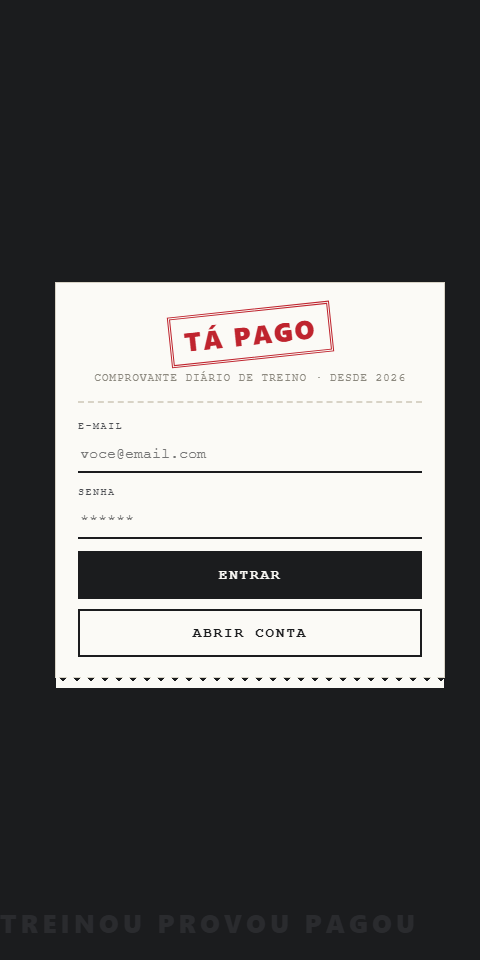

# tapago-diario-treino

Tá Pago: diário de treino em formato de comprovante. App Android com Capacitor.

"Treinou, provou, pagou": diário de treino com visual de comprovante impresso.

## Stack
HTML, CSS e JavaScript puro, com dados salvos no aparelho, empacotado como app Android com Capacitor.

## Rodar
Abra `www/index.html` no navegador, ou gere o app: `npm install && npx cap sync android && npx cap open android`.

---
Feito por [Gabriel Ferreira](https://github.com/GABRIELFERR9).
